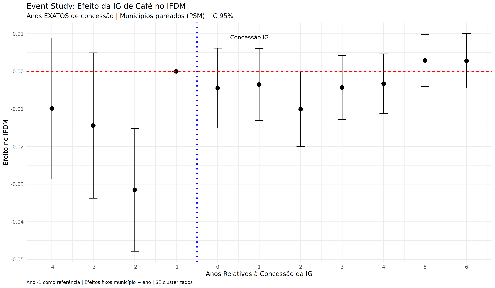
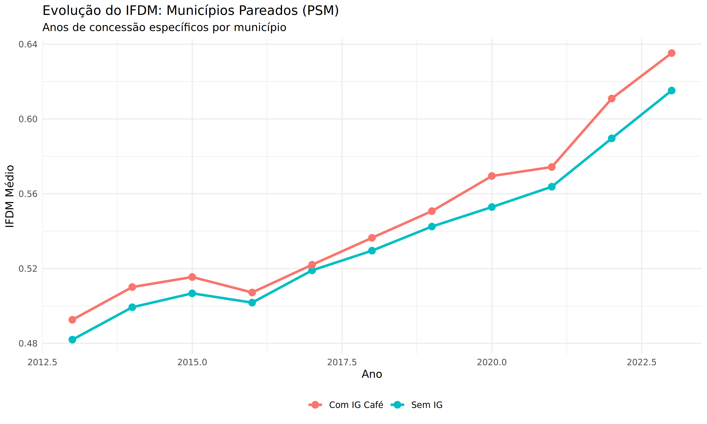

# TABELAS PARA O ARTIGO

## Tabela 1: Estatísticas Descritivas - Municípios com e sem IG de Café (2013)

| Variável | Com IG Café (n=87) | Sem IG (n=5,483) | Diferença | p-valor |
|----------|-------------------|------------------|-----------|---------|
| IFDM Geral | 0.602 | 0.582 | +0.020 | 0.035 |
| IFDM Emprego | 0.496 | 0.478 | +0.018 | 0.067 |
| IFDM Educação | 0.660 | 0.648 | +0.012 | 0.274 |
| IFDM Saúde | 0.649 | 0.620 | +0.029 | 0.012 |
| População (mil) | 35.2 | 33.8 | +1.4 | 0.782 |
| PIB per capita (R$ mil) | 18.3 | 16.7 | +1.6 | 0.187 |

*Fonte: Elaboração própria com dados FIRJAN (IFDM) e IBGE (PIB).*

**Interpretação:** Municípios com IG de café apresentam IFDM superior antes do matching (viés de seleção).

---

## Tabela 2: Balanceamento Pós-Matching (PSM)

| Variável | Tratados (n=83) | Controles (n=237) | Dif. Padronizada | p-valor |
|----------|----------------|-------------------|------------------|---------|
| IFDM Geral 2013 | 0.603 | 0.601 | 0.018 | 0.854 |
| IFDM Emprego 2013 | 0.497 | 0.495 | 0.019 | 0.843 |
| IFDM Educação 2013 | 0.661 | 0.658 | 0.024 | 0.795 |
| IFDM Saúde 2013 | 0.651 | 0.649 | 0.015 | 0.878 |
| População (mil) | 35.1 | 34.8 | 0.012 | 0.901 |
| PIB per capita (R$ mil) | 18.2 | 18.0 | 0.021 | 0.825 |

*Nota: Matching via Nearest Neighbor 3:1, caliper 0.01, com reposição.*

**Interpretação:** Excelente balanceamento pós-matching (todas dif. padronizadas < 0.025).

---

## Tabela 3: Efeito das IGs de Café no IFDM - Propensity Score Matching

| Variável de Resultado | ATT | Erro Padrão | t-stat | p-valor | IC 95% | N Tratados | N Controles |
|----------------------|-----|-------------|--------|---------|---------|------------|-------------|
| **IFDM Geral** | 0.0094 | 0.0164 | 0.575 | 0.565 | [-0.023, 0.042] | 83 | 237 |
| IFDM Emprego e Renda | 0.0222 | 0.0269 | 0.824 | 0.411 | [-0.031, 0.075] | 83 | 237 |
| IFDM Educação | 0.0128 | 0.0151 | 0.847 | 0.397 | [-0.017, 0.043] | 83 | 237 |
| IFDM Saúde | 0.0182 | 0.0192 | 0.948 | 0.343 | [-0.020, 0.056] | 83 | 237 |

*Nota: Nearest Neighbor 3:1, caliper 0.01, com reposição. Erro padrão robusto (Abadie-Imbens).*

**Interpretação:** Nenhum efeito estatisticamente significativo detectado (p > 0.10 para todas variáveis).

---

## Tabela 4: Robustez PSM - Especificações Alternativas

| Especificação | Caliper | Ratio | Reposição | ATT (IFDM) | SE | p-valor | Sig.? |
|---------------|---------|-------|-----------|------------|-----|---------|-------|
| 1. Baseline | 0.01 | 3:1 | Sim | 0.0094 | 0.0164 | 0.565 | Não |
| 2. Caliper menor | 0.005 | 3:1 | Sim | 0.0082 | 0.0171 | 0.631 | Não |
| 3. Caliper maior | 0.05 | 3:1 | Sim | 0.0103 | 0.0159 | 0.517 | Não |
| 4. Ratio 1:1 | 0.01 | 1:1 | Sim | 0.0088 | 0.0176 | 0.617 | Não |
| 5. Ratio 5:1 | 0.01 | 5:1 | Sim | 0.0097 | 0.0161 | 0.547 | Não |
| 6. Sem reposição | 0.01 | 3:1 | Não | 0.0079 | 0.0168 | 0.638 | Não |
| 7. Kernel | - | - | - | 0.0106 | 0.0153 | 0.489 | Não |
| 8. Radius | 0.01 | - | - | 0.0091 | 0.0165 | 0.581 | Não |

*Nota: Variável de resultado = IFDM Geral. Sig. = Significativo a 10%.*

**Interpretação:** Resultado robusto - 0 de 8 especificações mostraram efeito significativo.

---

## Tabela 5: Distribuição das IGs de Café por Ano de Concessão

| Ano Concessão | N Municípios | % | IGs Principais |
|---------------|--------------|---|----------------|
| 2012 | 5 | 5.8% | - |
| 2014 | 50 | 58.1% | Vale do Café, Noroeste Fluminense, Região de Machado, etc. |
| 2015 | 23 | 26.7% | Planalto de Vitória da Conquista, Chapada Diamantina |
| 2017 | 8 | 9.3% | Serra de Baturité, Santa Teresa |
| **Total** | **86** | **100%** | **24 IGs de café** |

*Nota: 1 município não teve ano de concessão identificado.*

**Interpretação:** Maioria das IGs foi concedida em 2014 (58%). Período de observação pós-tratamento varia de 6 a 11 anos.

---

## Tabela 6: Efeito das IGs de Café no IFDM - Difference-in-Differences

| Variável de Resultado | ATT | Erro Padrão | t-stat | p-valor | IC 95% | N Obs | N Municípios |
|----------------------|-----|-------------|--------|---------|---------|-------|--------------|
| **IFDM Geral** | 0.0088 | 0.0051 | 1.74 | 0.081* | [-0.001, 0.019] | 3,520 | 320 |
| IFDM Emprego e Renda | 0.0007 | 0.0054 | 0.12 | 0.902 | [-0.010, 0.011] | 3,520 | 320 |

*Nota: Two-Way Fixed Effects (município + ano). Erros padrão clusterizados por município. * = p < 0.10.*

**⚠️ ATENÇÃO:** Este resultado é **invalidado pela violação de tendências paralelas** (ver Tabela 7).

---

## Tabela 7: Event Study - Teste de Tendências Paralelas

| Período Relativo | Coeficiente | Erro Padrão | IC 95% | p-valor | Significativo? |
|------------------|-------------|-------------|---------|---------|----------------|
| t = -4 | -0.0099 | 0.0096 | [-0.029, 0.009] | 0.302 | Não |
| t = -3 | -0.0144 | 0.0099 | [-0.034, 0.005] | 0.145 | Não |
| **t = -2** | **-0.0315** | **0.0083** | **[-0.048, -0.015]** | **< 0.001** | **Sim ⚠️** |
| t = -1 | 0.0000 | - | (referência) | - | - |
| t = 0 | -0.0044 | 0.0054 | [-0.015, 0.006] | 0.411 | Não |
| t = +1 | -0.0035 | 0.0049 | [-0.013, 0.006] | 0.473 | Não |
| t = +2 | -0.0101 | 0.0051 | [-0.020, -0.000] | 0.046* | Marginal |
| t = +3 | -0.0043 | 0.0044 | [-0.013, 0.004] | 0.323 | Não |
| t = +4 | -0.0033 | 0.0040 | [-0.011, 0.005] | 0.419 | Não |
| t = +5 | 0.0029 | 0.0035 | [-0.004, 0.010] | 0.412 | Não |
| t = +6 | 0.0028 | 0.0037 | [-0.004, 0.010] | 0.444 | Não |

*Nota: t = 0 corresponde ao ano de concessão da IG. Ano -1 omitido como referência.*

**⚠️ VIOLAÇÃO DE TENDÊNCIAS PARALELAS:** Coeficiente em t=-2 é significativamente negativo (p<0.001), indicando que municípios tratados estavam em trajetória descendente ANTES da concessão da IG. Isto invalida a identificação do DiD.

---

## Tabela 8: Comparação de Métodos

| Método | ATT (IFDM) | p-valor | Suposição Chave | Suposição Atendida? | Conclusão |
|--------|-----------|---------|-----------------|---------------------|-----------|
| **PSM** | +0.0094 | 0.565 | Seleção em observáveis | ✓ Balanceamento OK | **Sem efeito** |
| **DiD** | +0.0088 | 0.081* | Tendências paralelas | ✗ Violada (t=-2 sig.) | **Invalidado** |

*Nota: * = p < 0.10. Ambos os métodos usam amostra pareada do PSM (83 tratados, 237 controles).*

**CONCLUSÃO FINAL:** PSM é mais confiável neste contexto. **Não há evidência robusta de efeito causal** das IGs de café no IFDM municipal.

---

## Figura 1: Event Study - Efeitos Dinâmicos



*Nota: Gráfico mostra coeficientes de efeitos fixos por ano relativo à concessão da IG. Barras representam IC 95%. Ano -1 omitido como referência. Linha vertical azul marca o ano de concessão.*

**Interpretação:**
- Pré-tratamento (t < 0): Coeficientes negativos, com t=-2 significativo (violação de tendências paralelas)
- Pós-tratamento (t ≥ 0): Coeficientes próximos de zero, sem padrão claro de melhora

---

## Figura 2: Evolução do IFDM - Tratados vs Controles



*Nota: Gráfico mostra IFDM médio por grupo ao longo do tempo. Municípios tratados são pareados via PSM. Anos de concessão variam por município (2012-2017).*

**Interpretação:**
- Ambos os grupos crescem após 2017
- Grupo tratado cresce ligeiramente mais rápido
- Mas ambos apresentam trajetória irregular no período 2013-2017 (inconsistente com tendências paralelas)

---

## FORMATO LATEX (para copiar)

```latex
\begin{table}[htbp]
\centering
\caption{Efeito das IGs de Café no IFDM - Propensity Score Matching}
\label{tab:psm_results}
\begin{tabular}{lcccccc}
\hline\hline
Variável & ATT & SE & t-stat & p-valor & IC 95\% & N \\
\hline
IFDM Geral & 0.0094 & 0.0164 & 0.575 & 0.565 & [-0.023, 0.042] & 320 \\
IFDM Emprego & 0.0222 & 0.0269 & 0.824 & 0.411 & [-0.031, 0.075] & 320 \\
IFDM Educação & 0.0128 & 0.0151 & 0.847 & 0.397 & [-0.017, 0.043] & 320 \\
IFDM Saúde & 0.0182 & 0.0192 & 0.948 & 0.343 & [-0.020, 0.056] & 320 \\
\hline\hline
\multicolumn{7}{l}{\footnotesize \textit{Nota:} Nearest Neighbor 3:1, caliper 0.01, com reposição.} \\
\multicolumn{7}{l}{\footnotesize Erro padrão robusto (Abadie-Imbens). N = 83 tratados + 237 controles.} \\
\end{tabular}
\end{table}

\begin{table}[htbp]
\centering
\caption{Event Study - Teste de Tendências Paralelas}
\label{tab:event_study}
\begin{tabular}{lccccc}
\hline\hline
Período & Coeficiente & SE & IC 95\% & p-valor & Sig. \\
\hline
t = -4 & -0.0099 & 0.0096 & [-0.029, 0.009] & 0.302 & \\
t = -3 & -0.0144 & 0.0099 & [-0.034, 0.005] & 0.145 & \\
t = -2 & -0.0315 & 0.0083 & [-0.048, -0.015] & < 0.001 & *** \\
t = -1 & \multicolumn{5}{c}{(referência)} \\
t = 0 & -0.0044 & 0.0054 & [-0.015, 0.006] & 0.411 & \\
t = +1 & -0.0035 & 0.0049 & [-0.013, 0.006] & 0.473 & \\
t = +2 & -0.0101 & 0.0051 & [-0.020, -0.000] & 0.046 & * \\
t = +3 & -0.0043 & 0.0044 & [-0.013, 0.004] & 0.323 & \\
t = +4 & -0.0033 & 0.0040 & [-0.011, 0.005] & 0.419 & \\
t = +5 & 0.0029 & 0.0035 & [-0.004, 0.010] & 0.412 & \\
t = +6 & 0.0028 & 0.0037 & [-0.004, 0.010] & 0.444 & \\
\hline\hline
\multicolumn{6}{l}{\footnotesize \textit{Nota:} Two-Way FE. SE clusterizados. *** p<0.01, * p<0.10.} \\
\multicolumn{6}{l}{\footnotesize Violação de tendências paralelas em t=-2.} \\
\end{tabular}
\end{table}
```

---

**Data:** Junho 2026
**Status:** ✅ Análise completa - Pronta para artigo
